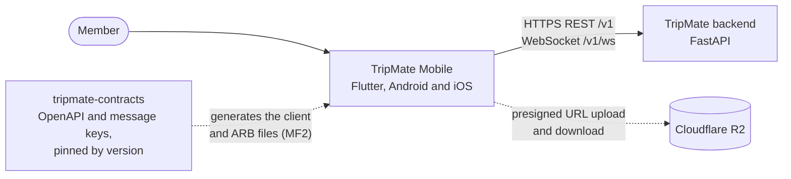
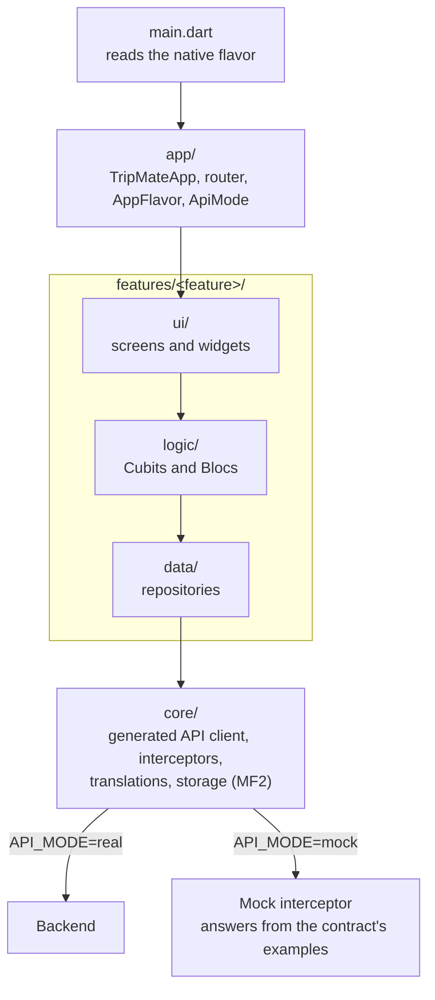

# tripmate-mobile

The TripMate Mobile client: one Flutter app for Android and iOS, built
for planning and following a group trip while travelling. It talks to
the TripMate backend over the versioned REST API and holds no domain
rules of its own.

| | |
|---|---|
| Status | EPIC-11, Platform Foundation. MF1 (skeleton and CI) is done; MF2 (API client and mock mode) is next. |
| Product documents | [tripmate-docs](https://github.com/huynguyennang-agilityio/tripmate-docs) |
| API contract | [tripmate-contracts](https://github.com/huynguyennang-agilityio/tripmate-contracts) |
| Tasks of this repository | [tasks/EPIC-11.md](tasks/EPIC-11.md) |
| Rules for contributors and AI agents | [CLAUDE.md](CLAUDE.md) |

## Contents

- [Tech stack](#tech-stack)
- [Architecture](#architecture)
- [Project structure](#project-structure)
- [Flavors and modes](#flavors-and-modes)
- [Getting started](#getting-started)
- [Commands](#commands)
- [Testing](#testing)
- [CI](#ci)
- [How work is done](#how-work-is-done)

## Tech stack

Versions are the ones pinned in this repository. "Planned" means a
later card adds it.

| Area | Technology | Version | Where it is set |
|------|------------|---------|-----------------|
| Framework | Flutter (stable) | **3.38.5**, exact | `pubspec.yaml`, `.github/workflows/ci.yml` |
| Language | Dart | **3.10.4**, exact | `pubspec.yaml` |
| State management | `flutter_bloc` (on `bloc` 9.2.1) | 9.1.1 | `pubspec.yaml`, `pubspec.lock` |
| Routing | `go_router` | 17.5.0 | `pubspec.yaml`, `pubspec.lock` |
| Lint | `flutter_lints` plus stricter rules | 6.0.0 | `analysis_options.yaml` |
| Tests | `flutter_test`, `bloc_test` | SDK, 10.0.0 | `pubspec.yaml` |
| HTTP client | Dio with a client generated by OpenAPI Generator (`dart-dio`) | Planned (MF2) | |
| Translations | ARB files generated from `tripmate-contracts`, Vietnamese and English | Planned (MF2) | |
| Android build | Android Gradle Plugin 8.11.1, Kotlin 2.2.20, Gradle 8.14, Java 17 | | `android/settings.gradle.kts`, `android/gradle/wrapper/` |
| Android SDK | minSdk 24 (Android 7.0), compileSdk and targetSdk 36 | Flutter 3.38.5 defaults | `android/app/build.gradle.kts` |
| iOS | Deployment target iOS 13.0; Xcode with an iOS simulator | | `ios/Runner.xcodeproj` |
| CI | GitHub Actions on `ubuntu-latest`, `subosito/flutter-action` | | `.github/workflows/ci.yml` |

The Flutter and Dart versions are exact on purpose: `flutter pub get`
fails with "version solving failed" on any other version, so every
machine and CI build with the same toolchain. To upgrade, change
`pubspec.yaml` (both lines) and `FLUTTER_VERSION` in the CI workflow
in one pull request.

## Architecture

### Where the app sits



- Every rule about money, voting, and Gaps runs in the backend. The app
  shows state and sends actions.
- The API client and the translation files are generated from one
  pinned version of `tripmate-contracts`; nobody edits them by hand. A
  CI check fails when they do not match that version (MF2).
- The whole system is described in
  [architecture.md](https://github.com/huynguyennang-agilityio/tripmate-docs/blob/main/docs/architecture.md).

### Inside the app



| Layer | Holds | May use | Never |
|-------|-------|---------|-------|
| `app/` | Root widget, routes, flavor, API mode | Every feature's `ui/` | Hold feature state |
| `features/<f>/ui/` | Screens and widgets | Its own `logic/` | Import another feature's `data/` or `logic/` |
| `features/<f>/logic/` | Cubits (simple screens) and Blocs (flows with many events) | Its own `data/` | Import another feature's `data/` or `logic/` |
| `features/<f>/data/` | Repositories over the generated client | `core/` | Import another feature's `data/` or `logic/` |
| `core/` | Generated client, headers (`X-Device-Id`, `Idempotency-Key`), mock interceptor, translations, storage | Generated code | Hold a feature's logic |

A feature reaches another feature only through `core/` or the router,
so cards that run at the same time do not change the same files.

## Project structure

```text
tripmate-mobile/
├── lib/
│   ├── main.dart                 Entry point: reads the flavor, starts TripMateApp
│   ├── app/
│   │   ├── app.dart              TripMateApp, the root widget
│   │   ├── flavor.dart           AppFlavor: dev, prod (ID, name)
│   │   ├── api_mode.dart         ApiMode: real, mock (from API_MODE)
│   │   └── router.dart           go_router routes
│   ├── core/                     (MF2) API client, interceptors, translations, storage
│   └── features/
│       └── home/
│           └── ui/home_screen.dart
├── test/                         Mirrors lib/
│   └── app/                      app_test, flavor_test, api_mode_test
├── android/                      Gradle project, dev and prod product flavors
├── ios/                          Xcode project, dev and prod schemes and configurations
├── tasks/                        Task files per epic, and review notes per card
├── .claude/agents/               The four agent roles (test, code, test-check, diff-review)
├── .github/workflows/ci.yml      Analyze, Test, Android build
├── analysis_options.yaml         Lint rules
├── pubspec.yaml / pubspec.lock   Dependencies, pinned toolchain
└── CLAUDE.md                     Setup, conventions, and how a card runs
```

A folder is created only when it gets its first file. Each new feature
follows `features/<feature>/{data,logic,ui}/`, and its tests go in
`test/features/<feature>/{data,logic,ui}/`.

## Flavors and modes

Two flavors install side by side on one phone.

| Flavor | Application / bundle ID | App name | Talks to |
|--------|-------------------------|----------|----------|
| `dev` | `com.tripmate.app.dev` | TripMate Dev | The local stack: `10.0.2.2:8000` from the Android emulator, `localhost:8000` from the iOS simulator |
| `prod` | `com.tripmate.app` | TripMate | Production |

Every run and build names a flavor. Separately, `API_MODE` chooses the
data source:

| `--dart-define=API_MODE=` | Data comes from |
|---------------------------|-----------------|
| (none) or any other value | The real backend of the flavor |
| `mock` | The contract's examples, through the mock interceptor (MF2); no backend needed |

How flavors are wired on Android and iOS is in
[CLAUDE.md](CLAUDE.md#flavors).

## Getting started

Prerequisites:

- Flutter **3.38.5** exactly, for example with
  [fvm](https://fvm.app): `fvm install 3.38.5 && fvm use 3.38.5`.
- Android Studio with the Android SDK and its JDK (17 or 21). Accept
  the licenses: `flutter doctor --android-licenses`.
- macOS only, for iOS: Xcode with an iOS simulator.

Clone the TripMate repositories side by side in one folder, then:

```sh
cd tripmate-mobile
flutter pub get
flutter doctor
flutter run --flavor dev
```

To run on a physical iPhone, put your own team in
`ios/Flutter/Signing.xcconfig` (`DEVELOPMENT_TEAM = <team ID>`). That
file is ignored by Git. The repository is public: never commit a
secret, `.env`, keystore, or token.

## Commands

| Task | Command |
|------|---------|
| Run `dev` | `flutter run --flavor dev -d <device>` |
| Run `prod` | `flutter run --flavor prod -d <device>` |
| Run without a backend | `flutter run --flavor dev --dart-define=API_MODE=mock` |
| List devices | `flutter devices` |
| Analyze, as CI | `flutter analyze --fatal-infos --fatal-warnings` |
| Format | `dart format lib test` |
| Test, as CI | `flutter test` |
| Android builds, as CI | `flutter build apk --debug --flavor dev` and `--flavor prod` |
| iOS simulator build | `flutter build ios --debug --simulator --flavor dev` (or `prod`) |

## Testing

| Level | Tool | Example |
|-------|------|---------|
| Unit | `flutter_test`, `bloc_test` | `test/app/flavor_test.dart` |
| Widget (screen) | `flutter_test` | `test/app/app_test.dart`: the first screen shows the flavor's name |
| Contract match | CI check | The generated client and ARB files match the pinned contract (MF2) |
| Manual | Checklist in the pull request | Both flavors on one phone, against the local stack |

The name of a test for a task's case starts with the case ID, for
example `MF1-4 dev flavor: first screen shows "TripMate Dev"`. Which
tests exist at which level is set in
[test-strategy.md](https://github.com/huynguyennang-agilityio/tripmate-docs/blob/main/docs/test-strategy.md).

## CI

`.github/workflows/ci.yml` runs on every pull request to `main` and
every push to `main`. Each job starts with
`flutter pub get --enforce-lockfile`, so CI uses exactly the committed
`pubspec.lock`.

| Job (required on `main`) | Runs |
|--------------------------|------|
| `Analyze` | `flutter analyze --fatal-infos --fatal-warnings` |
| `Test` | `flutter test` |
| `Android build` | Debug APKs of `dev` and `prod` |

`main` is protected: every change goes through a pull request, the
branch must be up to date with `main`, and all three jobs must pass.

## How work is done

Each change is one Trello card, built from its task in
[tasks/](tasks/) by four agents in separate sessions: a test agent
writes the tests first, a code agent writes the code, a test-check
agent checks both before the pull request, and a diff-review agent
reviews the pull request in two rounds. The steps, the risk levels, and
the Definition of Done are in
[development-flow.md](https://github.com/huynguyennang-agilityio/tripmate-docs/blob/main/docs/development-flow.md);
how they apply here is in [CLAUDE.md](CLAUDE.md).
